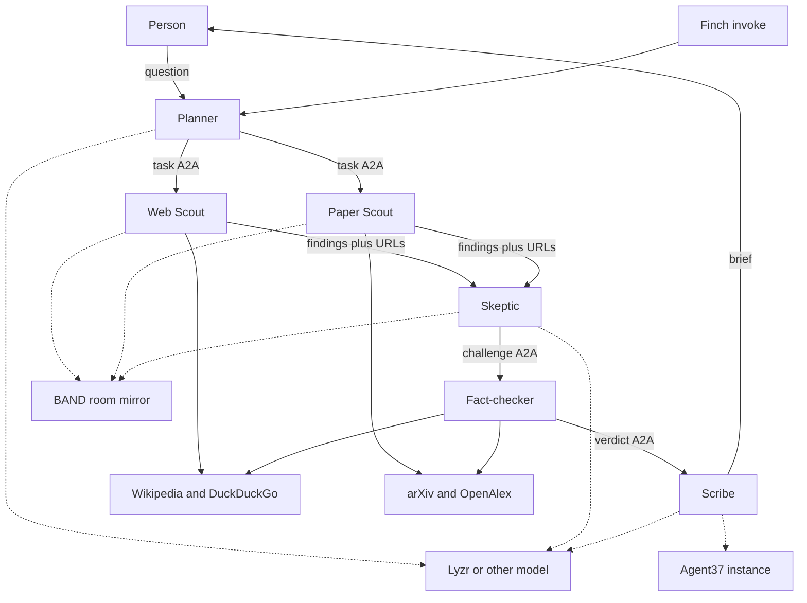

# ShodhSabha

A research council for the HiDevs A2A Diwali Festiverse India 2026, Research track.

You ask one question. Six agents talk where you can see them. A scribe writes a cited brief with a confidence score, open questions, and Markdown or PDF export. The score comes from a quote check against pages the scouts actually fetched, not from how sure a model sounds.

No API keys are required. Three recorded runs replay a real keyless gather. Any other question is gathered live from public sources and written up without a model. Add a Lyzr key (or OpenAI, Groq, or Gemini) and the same seats reason live.

## Council



A2A here is a message with `messageId`, `contextId`, `taskId`, `from`, `to`, and a kind: task, finding, challenge, verdict, or brief. The thread on the left is that stream. BAND, when configured, gets a copy of each live line.

## Run

```bash
npm install
npm run dev
```

Open http://localhost:3000 and convene a recorded question. The three chips are the captures.

```bash
npm test
npm run build
```

Recapture the recordings after you change the keyless writer:

```bash
npm run capture
```

BAND inbound mentions, on a machine that stays up:

```bash
npm run band:bridge
```

## Env

See `.env.example`. Empty is a valid setup.

| Variable | Role |
| --- | --- |
| `LYZR_API_KEY`, `LYZR_AGENT_ID` | Preferred live brain. Optional per-seat `LYZR_*_AGENT_ID`. |
| `OPENAI_API_KEY`, `GROQ_API_KEY`, `GEMINI_API_KEY` | Fallback brains, in that order, if Lyzr is not fully set. |
| `BAND_API_KEY`, `BAND_AGENT_ID`, `BAND_CHAT_ID`, `BAND_MENTION_HANDLE` | Mirror live lines into a room. Mention id is optional. |
| `FINCH_KEY_ID`, `FINCH_REQUEST_SECRET` | Sign the hosted runtime. Omit them to answer unsigned. |
| `AGENT37_API_KEY`, `AGENT37_INSTANCE_URL` | Second scribe. `AGENT37_AUTO_CREATE=true` spends credit. |
| `ADAL_ENABLED` | Shell out to a logged-in `adal` CLI during live runs. |
| `OPENALEX_API_KEY` | Optional. Anonymous OpenAlex shares a small daily budget. |
| `DEMO_PACE_MS` | Delay between recorded messages. Default 700. |

Sponsor notes, including what is real and what is still a TODO, live in [docs/SPONSORS.md](docs/SPONSORS.md). Paste-ready form answers are in [docs/SUBMISSION.md](docs/SUBMISSION.md).

## Finch URLs

Point a Finch hosted-agent runtime at the deployed origin:

- `GET /api/finch/health`
- `POST /api/finch/invoke`
- `GET /api/finch/tasks/{merchant_task_id}`

A local check without a signature:

```bash
curl -s http://localhost:3000/api/finch/health
curl -s http://localhost:3000/api/finch/invoke \
  -H 'content-type: application/json' \
  -d '{"question":"What does the latest evidence say about LLM hallucination fixes?"}'
```

## Layout

- `lib/council.ts` runs recorded, keyless, and live sessions.
- `lib/sources.ts` fetches the four public sources.
- `lib/verify.ts` is the fact checker.
- `lib/llm.ts` and `lib/sponsors.ts` are the vendor adapters.
- `finch/skills/citation-discipline` is the skill the prompts load.
- `adal/skills/shodh-scout` is the note for the AdaL CLI.
- `data/demos` holds the three recordings.
- `demo/shodhsabha-demo.mp4` is the walkthrough.
